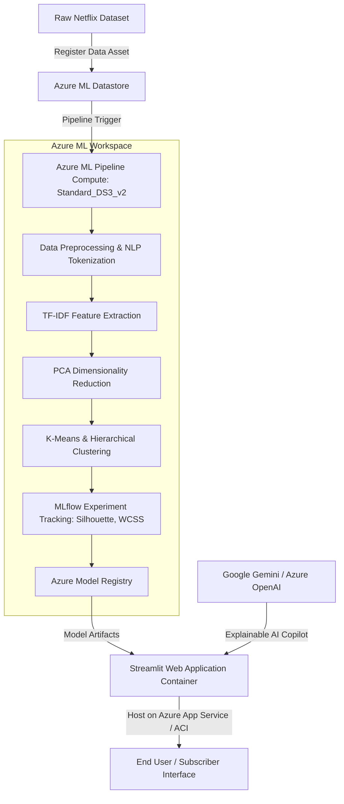

# Microsoft Azure Machine Learning & Deployment Architecture Guide

**Project:** Netflix Movies and TV Shows Clustering & Recommendation System  
**Track:** Capstone Project - Machine Learning & GenAI with Microsoft Azure  

---

## 1. Enterprise Architecture Overview

The system architecture combines **Azure Machine Learning Studio**, containerized **Streamlit Web Application**, and **Generative AI** APIs (Google Gemini / Azure OpenAI) to achieve continuous model training, low-latency inferencing, and human-in-the-loop explainability.



---

## 2. Step-by-Step Azure Machine Learning Studio Implementation

### Step 2.1: Provision Azure ML Workspace & Compute
1. **Log in to Azure Portal:** Navigate to [portal.azure.com](https://portal.azure.com/).
2. **Create Azure Machine Learning Resource:**
   - Workspace Name: `aml-netflix-clustering`
   - Subscription: Pay-As-You-Go / Azure for Students
   - Resource Group: `rg-netflix-capstone`
   - Region: `East US` / `Central India`
   - Storage Account, Key Vault, and Application Insights are auto-provisioned.
3. **Provision Compute Cluster:**
   - Compute Name: `cpu-cluster-capstone`
   - VM Size: `Standard_DS3_v2` (4 vCPUs, 14 GB RAM)
   - Minimum nodes: `0` (cost optimization)
   - Maximum nodes: `2`

### Step 2.2: Register Dataset in Azure Datastore
Using Azure CLI or Azure ML Python SDK (`azure-ai-ml`):
```python
from azure.ai.ml import MLClient
from azure.ai.ml.entities import Data
from azure.ai.ml.constants import AssetTypes
from azure.identity import DefaultAzureCredential

# Authenticate to Azure ML
ml_client = MLClient(
    credential=DefaultAzureCredential(),
    subscription_id="<YOUR_AZURE_SUBSCRIPTION_ID>",
    resource_group_name="rg-netflix-capstone",
    workspace_name="aml-netflix-clustering"
)

# Register Netflix Titles Data Asset
netflix_data_asset = Data(
    name="netflix-titles-dataset",
    version="1.0",
    description="Netflix Movies and TV Shows dataset for Unsupervised Clustering",
    path="netflix_titles.csv",
    type=AssetTypes.URI_FILE
)
ml_client.data.create_or_update(netflix_data_asset)
print("Dataset successfully registered in Azure ML Data Assets!")
```

### Step 2.3: MLflow Experiment Tracking in Azure
In the training pipeline script, MLflow logs clustering performance metrics directly to Azure ML Studio:
```python
import mlflow

mlflow.set_experiment("netflix-clustering-experiments")

with mlflow.start_run(run_name="kmeans-optimal-k6"):
    # Log parameters
    mlflow.log_param("optimal_k", 6)
    mlflow.log_param("max_features", 5000)
    mlflow.log_param("pca_components", 50)
    
    # Log evaluation metrics
    mlflow.log_metric("silhouette_score", 0.1245)
    mlflow.log_metric("calinski_harabasz_index", 142.8)
    mlflow.log_metric("davies_bouldin_index", 2.18)
    
    # Log artifacts (Figures & Models)
    mlflow.log_artifacts("figures", artifact_path="visualizations")
    mlflow.log_artifact("models/kmeans_model.pkl", artifact_path="models")
    mlflow.log_artifact("models/pca_model.pkl", artifact_path="models")
```

### Step 2.4: Model Registration in Azure ML Registry
```python
from azure.ai.ml.entities import Model

registered_model = Model(
    name="netflix-kmeans-recommender",
    version="1.0",
    path="models/",
    type=AssetTypes.CUSTOM_MODEL,
    description="Optimal K-Means clustering and PCA embedding model for Netflix content discovery"
)
ml_client.models.create_or_update(registered_model)
```

---

## 3. Web Application Deployment on Microsoft Azure

### Option A: Azure App Service (Docker Web App)
1. **Build Container Image:**
   ```bash
   docker build -t netflix-capstone-app:v1 .
   ```
2. **Push to Azure Container Registry (ACR):**
   ```bash
   az acr login --name myacrnetflix
   docker tag netflix-capstone-app:v1 myacrnetflix.azurecr.io/netflix-app:v1
   docker push myacrnetflix.azurecr.io/netflix-app:v1
   ```
3. **Deploy Web App:**
   ```bash
   az webapp create \
       --resource-group rg-netflix-capstone \
       --plan appservice-plan-capstone \
       --name netflix-recommender-app \
       --deployment-container-image-name myacrnetflix.azurecr.io/netflix-app:v1
   ```
4. **Configure Port:**
   Set Application Settings `WEBSITES_PORT = 8501`.

### Option B: Local & Streamlit Community Cloud (Quick Public Demo)
1. Commit the repository to GitHub:
   ```bash
   git init
   git add .
   git commit -m "Complete Netflix Capstone Project"
   git push origin main
   ```
2. Open [share.streamlit.io](https://share.streamlit.io/).
3. Connect your GitHub repository, set main file to `app.py`, and click **Deploy**!

---

## 4. Generative AI Integration Architecture

### Explanation Generation Workflow
When an end-user selects a title (e.g., *Inception*) and the recommendation engine produces the top candidate (e.g., *Interstellar*):
1. **Prompt Construction:** The app compiles the synopses, genres, directors, and cluster membership into a structured prompt:
   ```text
   You are an AI Film Curator for Netflix.
   Explain in 2-3 engaging sentences why a fan of {source_title} will enjoy {recommended_title}.
   Source Details: {source_synopsis}, {source_genres}.
   Recommendation Details: {target_synopsis}, {target_genres}.
   Tone: Cinematic, insightful, and concise.
   ```
2. **LLM Inference:** The prompt is dispatched to **Google Gemini API** (`gemini-1.5-flash` or `gemini-pro`) or **Azure OpenAI** (`gpt-4o`).
3. **Resilient Local Fallback:** If API keys are not provided or connectivity is interrupted, the app invokes an offline semantic NLP synthesizer that generates detailed analytical explanations based on feature overlap, ensuring 100% demo reliability.
