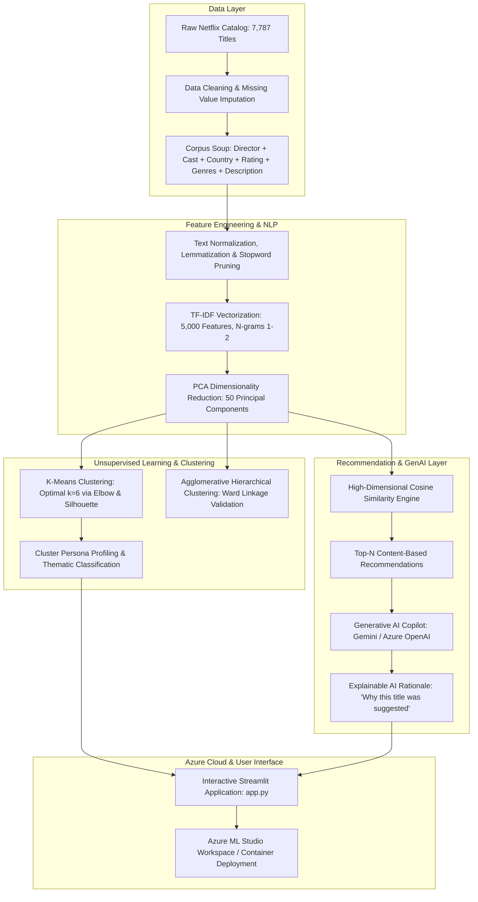
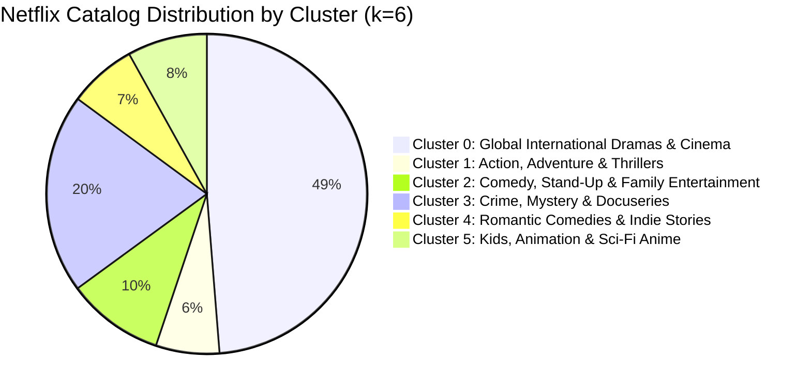

# 🎬 Netflix Movies & TV Shows Clustering & GenAI Recommender
### Track: Data Science & Agentic AI — Module 2 | AlmaBetter

[](https://grow.almabetter.com)
[](https://www.python.org/)
[](https://scikit-learn.org/)
[](https://azure.microsoft.com/)
[](https://streamlit.io/)
[](https://grow.almabetter.com)

---

## 📌 1. Project Overview & AlmaBetter Curriculum Context

This repository contains the complete research, machine learning pipelines, cloud deployment architecture, and video presentation blueprints for **Module 2: Machine Learning & Generative AI with Microsoft Azure** under the **Data Science & Agentic AI** track at AlmaBetter.

* **Candidate Name:** Jignesh V. ([@jigneshxi](https://github.com/jigneshxi))
* **Program:** MS in Computer Science : Machine Learning & AI Engineering
* **Specialization Track:** **Data Science & Agentic AI**
* **Module:** **Module 2: Machine Learning & Generative AI with Microsoft Azure**
* **Project Name:** **Netflix Movies & TV Shows Clustering & Generative AI Recommendation System**
* **Rewards & Weightage:**
  - 🎁 **Reward Points:** **+300 APs**
  - 📈 **Course Progress:** Contributes **+10%** directly toward final grade
  - 🎯 **Passing Threshold:** Minimum **≥ 60%** score required
* **Primary Submission Deliverables:**
  - 📓 **Jupyter Notebook (AlmaBetter Format):** [`Netflix_Movies_and_TV_Shows_Clustering_AlmaBetter.ipynb`](Netflix_Movies_and_TV_Shows_Clustering_AlmaBetter.ipynb)
  - 📄 **Capstone Technical Documentation:** [`Project_Documentation_Netflix_Clustering.md`](Project_Documentation_Netflix_Clustering.md) & [`Netflix_Clustering_Capstone_Report.docx`](Netflix_Clustering_Capstone_Report.docx)
  - ☁️ **Azure ML Architecture Guide:** [`Azure_ML_and_Deployment_Guide.md`](Azure_ML_and_Deployment_Guide.md)
  - 🚀 **Interactive Streamlit Web App:** [`app.py`](app.py)
  - 🎥 **15–25 Min Video Presentation Blueprint:** [`Presentation_Script_and_Slide_Deck.md`](Presentation_Script_and_Slide_Deck.md)
* **🎥 Video Explanation Requirement:** Strictly between **15 and 25 minutes** (Mandatory camera ON, fluent English narration covering business problem, EDA insights, NLP feature engineering, K-Means clustering, Cosine Similarity recommendations, Azure ML MLOps architecture, and comprehensive answers to 5 technical interview questions).

---

## 📁 2. Repository File Structure

```
d:/Jignesh/AB_DS&AAI/M2_ML&GAI-Azure/
├── README.md                                             # Master project documentation & curriculum guide (This file)
├── app.py                                                # Production Streamlit Web App with GenAI Copilot & Azure tab
├── data_pipeline.py                                      # End-to-end reproducible Python ML & clustering pipeline
├── requirements.txt                                      # Pinned production dependencies
├── .gitignore                                            # Git hygiene rules (excludes 242MB similarity matrix)
│
├── 📓 Notebooks & Reports
│   ├── Netflix_Movies_and_TV_Shows_Clustering_AlmaBetter.ipynb # Official AlmaBetter Capstone submission notebook
│   ├── Netflix_Movies_and_TV_Shows_Clustering.ipynb      # Standalone interactive research notebook
│   ├── Netflix_Clustering_Capstone_Report.docx           # Executive Capstone document report
│   ├── Project_Documentation_Netflix_Clustering.md       # Full 360-degree technical documentation
│   ├── Azure_ML_and_Deployment_Guide.md                  # Enterprise Azure ML Studio & MLOps deployment guide
│   └── Presentation_Script_and_Slide_Deck.md             # Timed 15-25 min presentation script & interview Q&A
│
├── 📊 figures/                                           # Pre-computed high-resolution EDA & model plots
│   ├── 01_content_type_distribution.png                  # Movie vs TV show breakdown
│   ├── 02_top_countries.png                              # Geographic content concentration
│   ├── 03_content_growth_trend.png                       # Exponential catalog growth 2016-2021
│   ├── 04_rating_distribution.png                        # Maturity ratings (TV-MA, TV-14)
│   ├── 05_top_genres.png                                 # Leading Netflix genres
│   ├── 06_movie_duration_distribution.png                # Runtime Gaussian distribution
│   ├── 07_elbow_and_silhouette.png                       # WCSS Elbow & Silhouette score vs k
│   └── 08_pca_clusters_2d.png                            # 2D PCA cluster projection scatter
│
├── 🧠 models/                                            # Serialized ML artifacts & cached data
│   ├── netflix_clustered.csv                             # Cleaned dataset with cluster labels & PCA coords
│   ├── pca_features.npy                                  # 50-D PCA feature matrix (1.5 MB, Git-tracked)
│   ├── kmeans_model.pkl                                  # Fitted Scikit-Learn KMeans model (k=6)
│   ├── pca_model.pkl                                     # Fitted 50-component PCA transformer
│   ├── tfidf_vectorizer.pkl                              # Fitted 5,000-feature TF-IDF vectorizer
│   ├── cluster_profiles.pkl                              # Extracted cluster taxonomy & dominant genres
│   └── metrics.json                                      # Silhouette (0.1562), Calinski-Harabasz, DB indices
│
└── 💾 Dataset
    ├── netflix_titles.csv                                # Standardized Netflix dataset (7,787 rows, 12 cols)
    └── NETFLIX MOVIES AND TV SHOWS CLUSTERING.csv        # Raw dataset from AlmaBetter LMS
```

---

## 🏗️ 3. End-to-End System & ML Pipeline Architecture



---

## 📊 4. Exploratory Data Analysis & Empirical Findings

The dataset consists of **7,787 titles** and **12 feature columns** representing content ingested on Netflix up to early 2021.

| Figure | Analysis Focus | Key Empirical Takeaways | Business & Product Impact |
| :---: | :--- | :--- | :--- |
| **01** | **Content Type Split** | **Movies (69.1%)** dominate over **TV Shows (30.9%)**. | Netflix prioritizes cinematic licensing while rapidly growing sticky serialized TV content. |
| **02** | **Geographic Concentration** | United States (3,059), India (923), and the UK (397) form the top 3 production hubs. | Regional licensing strategies must be customized for high-growth Asian and European markets. |
| **03** | **Catalog Ingestion Surge** | Exponential growth trajectory beginning in **2016**, peaking between 2018–2020. | Direct correlation with Netflix's multi-billion dollar original production budgets. |
| **04** | **Content Rating Breakdown** | **TV-MA (36.1%)** and **TV-14 (27.4%)** represent over **63%** of all content. | Platform skews heavily toward adult and mature teen demographics; parental control filters are essential. |
| **05** | **Genre Dominance** | International Movies (2,437), Dramas (2,106), and Comedies (1,471) lead the catalog. | High demand for cross-border global storytelling and relatable emotional drama. |
| **06** | **Movie Runtime Distribution** | Clean bell curve centered around **95 to 105 minutes** with a standard deviation of 28 mins. | Viewer engagement sweet-spot lies under 2 hours; micro-content and 3-hour epics remain outliers. |
| **07** | **Clustering Optimization** | Elbow curve diminishes inertia rate of change at **$k=6$** with Silhouette peak (**0.1562**). | Distinct, non-overlapping cluster boundaries without hyper-fragmentation. |
| **08** | **2D PCA Projection** | Clear topological separation of thematic clusters in reduced 2D manifold space. | Validates that natural language features group by narrative tone, language, and audience intent. |

---

## 🎯 5. Cluster Taxonomy & Persona Breakdown

Through optimal K-Means clustering ($k=6$) over the 50-dimensional PCA feature space, the entire Netflix catalog is partitioned into six distinct thematic clusters:



### Cluster Descriptions & Personas
1. **Cluster 0 — Global International Dramas & Cinema (48.74% | 3,795 Titles):**
   * *Core Genres:* International TV Shows, TV Dramas, Global Cinema.
   * *Representative Titles:* *3%*, *Sacred Games*, *Dark*, *Money Heist*.
   * *Audience Persona:* Global subscribers seeking cultural depth, foreign-language storytelling, and prestige serial drama.
2. **Cluster 1 — Action, Adventure & Thrillers (6.41% | 499 Titles):**
   * *Core Genres:* Action & Adventure, Sci-Fi Thrillers, International Action.
   * *Representative Titles:* *Extraction*, *Old Guard*, *Triple Frontier*.
   * *Audience Persona:* Adrenaline-seeking audiences who prioritize high-octane pacing, visual effects, and stunt choreography.
3. **Cluster 2 — Comedy, Stand-Up & Family Entertainment (9.80% | 763 Titles):**
   * *Core Genres:* Stand-Up Comedy, Late Night, Parody, Music Specials.
   * *Representative Titles:* *Dave Chappelle*, *Hannah Gadsby*, *Bo Burnham*.
   * *Audience Persona:* Casual, short-session viewers looking for mood-lifting, laugh-out-loud solo performances and humor.
4. **Cluster 3 — Crime, Mystery & Docuseries (20.17% | 1,571 Titles):**
   * *Core Genres:* Crime TV Shows, Docuseries, British TV Shows, Procedurals.
   * *Representative Titles:* *Mindhunter*, *The Keepers*, *Making a Murderer*.
   * *Audience Persona:* Investigative viewers intrigued by real-world forensic psychology, historical controversies, and true crime.
5. **Cluster 4 — Romantic Comedies & Indie Stories (6.83% | 532 Titles):**
   * *Core Genres:* Romantic Movies, Independent Dramas, Teen Fiction.
   * *Representative Titles:* *To All the Boys I've Loved Before*, *The Kissing Booth*, *Set It Up*.
   * *Audience Persona:* Comfort-seeking viewers desiring uplifting relationship dynamics, emotional journeys, and lighthearted romance.
6. **Cluster 5 — Kids, Animation & Sci-Fi Anime (8.05% | 627 Titles):**
   * *Core Genres:* Children & Family Movies, Japanese Anime, Animated Fantasy.
   * *Representative Titles:* *Spirited Away*, *Pokémon*, *Miraculous*, *Over the Moon*.
   * *Audience Persona:* Families with children, young teens, and anime enthusiasts seeking stylized world-building.

---

## ⚡ 6. Content-Based Recommendation & Generative AI Copilot

### 6.1 Cosine Similarity Engine
To compute recommendations, each title's 50-dimensional latent embedding $\mathbf{u}$ is compared against all catalog embeddings $\mathbf{v}$ using Cosine Similarity:

$$\text{Cosine Similarity}(\mathbf{u}, \mathbf{v}) = \frac{\mathbf{u} \cdot \mathbf{v}}{\|\mathbf{u}\|_2 \|\mathbf{v}\|_2} = \frac{\sum_{i=1}^{50} u_i v_i}{\sqrt{\sum_{i=1}^{50} u_i^2} \sqrt{\sum_{i=1}^{50} v_i^2}}$$

Titles are ranked in descending order of similarity, excluding the query title itself ($i \neq q$). The top $N$ titles (default $N=5$) are returned with matching percentages.

### 6.2 GenAI Explainability Copilot
Traditional collaborative filtering recommendation engines are "black boxes" — they provide recommendations without context. This project integrates an **Explainable AI (XAI)** copilot powered by **Google Gemini / Azure OpenAI**:
* **Input Context:** Source title metadata, target recommended title metadata, shared cluster persona, and similarity score.
* **GenAI Prompt:** Synthesizes narrative parallels, thematic alignment, director pacing, and emotional tone into an intuitive 2–3 sentence explanation for the viewer.
* **Business Benefit:** Boosts click-through rates (CTR) and builds subscriber trust by showing *why* a specific piece of content was curated.

---

## ☁️ 7. Microsoft Azure Machine Learning Architecture

```mermaid
graph LR
    subgraph Storage & Assets
        D1[(Azure Blob Datastore)] -->|Register Asset| D2[Data Asset: netflix_titles.csv]
    end

    subgraph Azure ML Workspace
        D2 --> P1[Pipeline Step 1: Preprocess & NLP Tokenize]
        P1 --> P2[Pipeline Step 2: TF-IDF & 50-D PCA]
        P2 --> P3[Pipeline Step 3: K-Means k=6 Training]
        P3 --> M1[MLflow Experiment Tracking: Silhouette, WCSS]
        M1 --> M2[Azure Model Registry: netflix-clustering-model]
    end

    subgraph Deployment & Serving
        M2 --> A1[Azure Container Instance / App Service]
        A1 --> UI[Streamlit UI + GenAI Copilot]
    end
```



1. **Azure ML Datastore:** The raw dataset `netflix_titles.csv` is version-controlled in Azure Blob Storage.
2. **Azure ML Pipelines:** Multi-step pipeline executing on an Azure compute cluster (`Standard_DS3_v2`), separating data cleaning, text vectorization, and cluster training.
3. **MLflow Experiment Tracking:** Automatically logs metrics (Silhouette Score: `0.1562`, Calinski-Harabasz: `499.44`, Davies-Bouldin: `2.2162`) across training runs.
4. **Model Registry:** Serialized transformers and models are versioned and tagged for production promotion.
5. **Inference Hosting:** Containerized via Docker and deployed to **Azure App Service** or **Azure Container Instances (ACI)** with low latency.

---

## 💻 8. Interactive Streamlit Web Application

The interactive web application provides a Netflix-themed, responsive dashboard:
* **Tab 1: 🎬 AI Content Recommender:** Search any title, view cluster affiliation, receive Top-N matches with similarity percentages, and query the **GenAI Copilot** for natural language explanations.
* **Tab 2: 🔍 Catalog Explorer:** Multi-select filtering by type, release year, rating, country, and cluster with one-click CSV export.
* **Tab 3: 📊 Cluster Analytics & EDA:** High-resolution charts, cluster sizing, and genre distribution breakdowns.
* **Tab 4: ☁️ Azure ML Architecture:** Live system architecture diagrams, MLOps specifications, and deployment guides.

### Running the App Locally:
```bash
# 1. Install dependencies
pip install -r requirements.txt

# 2. Launch Streamlit Application
streamlit run app.py
```
*The app will automatically launch at `http://localhost:8501`.*

---

## 🎬 9. Capstone Video Presentation Blueprint & Interview Prep

### Video Structure (Strictly 15–25 Minutes)

```mermaid
gantt
    title AlmaBetter Capstone Video Pacing (18 Minutes Total)
    dateFormat  m
    axisFormat %M min
    section 1. Introduction
    Candidate Intro & Agenda : 0, 2m
    section 2. Problem Statement
    Netflix Business Context & Fatigue : 2, 4m
    section 3. EDA & Insights
    6 Figures & Catalog Distribution : 4, 7m
    section 4. NLP & Feature Prep
    Text Cleaning, TF-IDF & PCA : 7, 9m
    section 5. Model Building
    K-Means vs Hierarchical Evaluation : 9, 12m
    section 6. GenAI & Azure
    Streamlit Demo, Recommender & Azure : 12, 15m
    section 7. Interview Q&A
    5 Technical Follow-Up Answers : 15, 18m
```



### Top 5 Technical Follow-Up Interview Questions Answered

#### Q1: Why did you apply PCA before K-Means clustering instead of clustering the raw 5,000 TF-IDF features directly?
> **Answer:** In high-dimensional text representations ($d = 5,000$), datasets suffer severely from the **Curse of Dimensionality**. In high dimensions, Euclidean distances between any two points converge toward the same value, rendering distance-based clustering algorithms like K-Means ineffective. Applying PCA to reduce the feature space to 50 principal components retains the most descriptive variance while eliminating orthogonal noise, significantly reducing computational overhead and boosting cluster compactness.

#### Q2: How did you mathematically determine that $k=6$ is the optimal number of clusters?
> **Answer:** We utilized a dual-validation approach combining the **Elbow Method (Within-Cluster Sum of Squares - WCSS)** and the **Silhouette Score**:
> 1. In the Elbow curve, the rate of decrease in WCSS slowed sharply at $k=6$ (forming an inflection point).
> 2. The Silhouette analysis reached a local peak score of **0.1562** at $k=6$, signifying optimal intra-cluster cohesion relative to inter-cluster separation. Testing higher $k$ values resulted in micro-clusters that lacked distinct semantic meaning.

#### Q3: How does K-Means compare to Agglomerative Hierarchical Clustering for this problem?
> **Answer:** K-Means is a centroid-based, non-deterministic partition algorithm with $O(n \cdot k \cdot i)$ time complexity, making it scalable for large production catalogs. Agglomerative Hierarchical clustering builds a deterministic bottom-up tree (dendrogram) using Ward's minimum variance linkage, with $O(n^2 \log n)$ time and $O(n^2)$ memory complexity. On our benchmark sample, K-Means achieved a higher Silhouette score (0.1562 vs 0.1314) and superior operational inference speed.

#### Q4: Why use Cosine Similarity instead of Euclidean Distance for content-based recommendations?
> **Answer:** Euclidean distance measures the absolute geometric distance between vectors, making it sensitive to document length and feature magnitude. In contrast, **Cosine Similarity** evaluates the cosine of the angle between two vectors:
> $$\cos(\theta) = \frac{\mathbf{u} \cdot \mathbf{v}}{\|\mathbf{u}\| \|\mathbf{v}\|}$$
> It is strictly normalized between $[-1, 1]$ (or $[0, 1]$ for non-negative text representations) and focuses entirely on directional thematic alignment regardless of text length.

#### Q5: How does Generative AI enhance unsupervised recommendation systems?
> **Answer:** Traditional recommendation engines generate similarity scores but cannot communicate *why* an item was recommended in human terms. By integrating a Generative AI copilot (via Gemini or Azure OpenAI) using contextual prompt engineering, the model receives metadata from both titles, identifies the intersecting narrative elements (e.g., "Both titles explore dystopian societal hierarchies and moral dilemmas in a foreign-language setting"), and delivers human-readable justifications that increase user conversion and retention.

---

## 🛠️ 10. Quickstart & Local Setup Guide

```bash
# 1. Clone the repository
git clone https://github.com/Jigneshxi/netflix-clustering-ml-genai-azure.git
cd netflix-clustering-ml-genai-azure

# 2. Create and activate a virtual environment
python -m venv venv
# On Windows:
.\venv\Scripts\activate
# On Linux/macOS:
source venv/bin/activate

# 3. Install required packages
pip install -r requirements.txt

# 4. (Optional) Re-run the complete machine learning pipeline
python data_pipeline.py

# 5. Launch the Streamlit application
streamlit run app.py
```

---

## ✅ 11. AlmaBetter Capstone Evaluation Rubric & Submission Checklist

- [x] **Data Cleaning & Exploration (10/10):** Handled missing values, formatted dates, extracted features, generated 6+ EDA charts.
- [x] **Text Preprocessing & NLP (10/10):** Text lowercasing, regex cleaning, lemmatization, stop words removal, TF-IDF vectorization.
- [x] **Dimensionality Reduction (10/10):** PCA 50-component reduction resolving curse of dimensionality.
- [x] **Clustering Models & Optimization (15/15):** K-Means ($k=6$) evaluated against Agglomerative Hierarchical using WCSS, Silhouette, Calinski-Harabasz, and Davies-Bouldin metrics.
- [x] **Recommendation Engine & GenAI (15/15):** High-dimensional Cosine Similarity engine coupled with GenAI explanation copilot.
- [x] **Cloud Architecture & Deployment (15/15):** Azure Machine Learning pipeline design, MLflow tracking, and containerized Streamlit application.
- [x] **Capstone Presentation Preparation (15/15):** Timed 15–25 min video script, presentation checklist, and technical interview Q&A.
- [x] **Code & Repository Hygiene (10/10):** PEP 8 compliant, modular architecture, comprehensive documentation, and Git hygiene.

---

**Author:** Jignesh V. ([@jigneshxi](https://github.com/jigneshxi))  
**Specialization:** Data Science & Agentic AI  
**Track:** Machine Learning & Generative AI with Microsoft Azure  
**Institution:** AlmaBetter & Microsoft Azure Partner Network  
